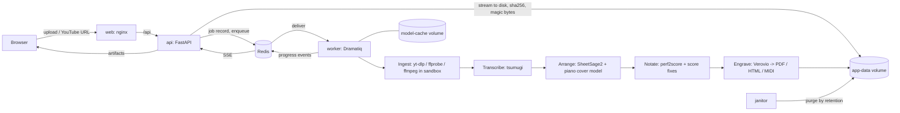

# PianoScribe 2 architecture

PianoScribe 2 is a rebuild of [the first PianoScribe](https://github.com/FriendlyUser/pianoscribe)
around one priority: the score has to be right. The first version transcribed with a 2021 piano
model and wrote notation with hand-made rules; measured against a published piano arrangement it
scored 0.40, then 0.73 after a second pass. This version replaces every musical stage with current
models from Hugging Face, scores 0.88 on the same reference (0.84 to 0.88 over nine arrangements), and keeps that number honest with tests against ground truth. Model choice, benchmarks and licences are in
[docs/MODELS.md](docs/MODELS.md); how accuracy is measured is in
[backend/eval/README.md](backend/eval/README.md).

The service layer (API, queue, ingestion sandbox, storage, engraving, web UI) is carried over from
version 1 and is described here as it now stands.

## Stack at a glance

| Concern | Choice | Why |
|---|---|---|
| API | Python 3.12, FastAPI, uvicorn | Typed request/response models, streaming request bodies, SSE |
| Job system | Dramatiq 2 on Redis 7 | At-least-once delivery, retries with backoff, dead-letter queue |
| Job state and progress | Redis (JSON records, pub/sub, per-job locks) | One dependency for queue, state and live updates |
| Decoding | ffmpeg / ffprobe, sandboxed | The only code that parses untrusted media |
| YouTube | yt-dlp (+ Deno JS runtime), sandboxed | Invoked only with a URL rebuilt from a validated video id |
| Stem separation + transcription | [tsumugi](https://github.com/anime-song/tsumugi) | Instrument-agnostic transcriber with its own stem workflow, instrument labels and a velocity model; matches the best piano-only model on MAESTRO |
| Beats, bars, meter, melody, chords; keys and key changes | [SheetSage2-Refined](https://huggingface.co/anime-song/SheetSage2-Refined) | One model for the whole metrical frame, including per-bar time signatures, and a key tracker that follows modulations |
| Arranging a song for piano | [tsumugi-piano-cover-v2](https://huggingface.co/anime-song/tsumugi-piano-cover-v2) | Generates a playable two-hand part that follows the original on its beat grid |
| Performance to notation | `piano_perf2score` (same repository) | Learned note values, voices, hands, ties, key and clef; writes MusicXML |
| Model runtime | Each model in the environment its authors lock, run as a subprocess | No dependency conflicts, GPU memory released between stages, a hang or crash cannot take the worker down |
| Canonical notation | MusicXML 4.0 | Open interchange format |
| Engraving | Verovio 6 | SVG pages, timing map and MIDI from the same loaded score |
| PDF | CairoSVG + pypdf | Vector PDF from the engraved pages, no browser in the worker |
| Frontend | React 18, TypeScript, Vite; nginx | Small static bundle, typed API client |
| Packaging | Docker Compose, multi-stage images | `docker compose up` runs everything |

## System diagram



## The three paths

```
song (band, vocals, orchestra, soundtrack)
  audio.wav ─► transcription.mid ─► annotation.json + performance.mid ─► score.musicxml ─► PDF / HTML / MIDI
              stems, every          beats, bars, meter,  a piano part     note values,
              instrument's notes    melody, chords       for two hands    hands, key

solo piano
  audio.wav ─► performance.mid ─► annotation.json ─► score.musicxml ─► PDF / HTML / MIDI
              the notes played,    beats, bars,
              with dynamics        meter

piano tutorial video (notes falling onto a keyboard)
  video ─► visual.json + performance.mid ─► annotation.json ─► score.musicxml ─► PDF / HTML / MIDI
           the notes shown: key, onset,     beats, bars,        written by rule,
           length, hand (no model)          meter, key (audio)  as read
```

**Song.** `tsumugi` separates the recording into stems and transcribes each one, giving a
multi-track MIDI of everything that sounds. `SheetSage2-Refined` listens to the recording for the
beat grid, bar lines, time signatures, melody and chords. The cover model then writes a piano
performance conditioned on both: it is a generative model, so the result is an *arrangement* that
a pianist can play, not a record of any one instrument. The cover is sampled with a fixed seed
(`PS_COVER_SEED`), so the same recording gives the same score.

**Solo piano** (the "This is already solo piano" option). Nothing is arranged. `tsumugi`
transcribes the recording restricted to the piano label, its velocity model adds dynamics, and
`SheetSage2-Refined` supplies the beat grid. The notes in the score are the notes that were played.

The first two paths end in the same notation stage, `piano_perf2score`, which reads a
performance against a beat grid and writes notation: note values, ties, voices, the split between
hands, key signatures and clefs.

**Piano tutorial video** (the "This is a piano tutorial video" option). The notes are not heard
but read from the picture, and not notated by a model but written down by rule. Both follow from
what such a video is: a piano roll drawn to the pixel, with each hand in its own colour. See the
next section.

### Reading a piano tutorial video

`app/visual/` measures; it runs no model.

1. **Keyboard** (`keyboard.py`). A few dozen frames are sampled and their median taken, which
   removes falling notes and lit keys. The band of black keys has a row pattern nothing else in a
   frame has; the lines between white keys lie on a lattice; black keys sit on five of every seven
   boundaries, a pattern with no symmetry, which names every key. Note names printed on the keys
   do not disturb this. Some tutorials film a real keyboard, with the player's hands on it and
   the notes drawn above: its rows are shaded, so about a fifth of each is neither clearly white
   nor clearly black. That looser level is tried only when no drawn keyboard is found: on a
   drawn one it moves where the rows end by a pixel and the keys' sides by a fraction of one,
   enough to lose the corners of touching bars (three notes in the first development video). A
   black key is wherever the picture is nearer black than white (its
   sloping sides catch the light). Where the hands rest most of the time they stay in the median;
   those columns (coloured, where keys are grey) are left out of the pattern, and the black keys
   under them placed where the others of their kind are.
2. **Roll** (`roll.py`). The notes scroll down at the speed of the music, so the video is a piano
   roll seen through a moving window. Every frame contributes a thin strip a little above the
   keyboard (above the flare drawn where notes land), and the strips are laid end to end by how
   far each still has to travel. One row of the rebuilt roll is one pixel of travel: 4 ms in a
   1080p video. A screen recording repeats and skips frames, so how far the picture really moved
   between two frames is measured rather than assumed (one of the two development videos moves
   0, 3, 9, 6, 1 ... rows from frame to frame). The strip is 1.6 white keys above the keyboard:
   the further up, the more such uneven motion blurs the moment a bar lands (the second
   development video read at 2.4 times its notes against its audio too loosely for the audio's
   timing to be applied, and they come 87 ms early). With a film behind the notes it is 2.4,
   clear of the flare that bursts where a note lands in the third development video (nearly two
   white keys high).

   Behind the notes is usually a still, nearly black picture, and whatever differs from it is a
   bar. Some videos play a dimmed film there instead. That is recognised in the sampled frames:
   they differ from their median in large areas far from anything as bright as a bar. Then only
   brightness tells a bar from the film, and a pixel counts only above the level that best splits
   the brightness of everything that changed (142 in the third development video, whose film
   peaks near 120 and whose bars start near 150). The dark outlines and the dark strokes of the
   note names inside a bar are as dim as the film; they are counted all the same where they fill
   a short gap between bright parts of a bar, shorter than the film between two bars.
3. **Bars.** Each key is read in the columns no other key's bar can cover; a black key's bar lies
   over the edges of two white keys and is read in two parts (a black key that lies almost all
   over one neighbour has no part over the other; beside that neighbour sounding, its bar is
   told by its own colour). A bar is there wherever its key's columns are not background. Two bars that touch (a quarter of all notes in the first
   development video) are told apart by the notch their rounded corners leave at the sides,
   which the note name printed inside a bar never reaches. More bars than two hands have
   fingers, on neighbouring keys and struck and released together, are one thing laid across
   the keyboard and are dropped: the second development video scrolls its title banner down
   over every key before the notes begin, which read higher up is 30 notes at once. A glissando,
   whose keys are struck one after the other, is kept. A piece of a bar shorter than a twentieth
   of a second, touching another on its key, is joined back to it: no key is struck twice that
   fast, and such slivers are false seams (four in the second development video). And a seam too
   faint to cut on outright (in a 720p picture two touching bars can leave a notch at one corner
   only, or one blurred to half the strip) is cut when something else agrees: the notch is half
   the depth of a plain one, or another key's bar has one at the same moment (a chord struck
   again), or it makes its bar one more of a run of repeated notes, or the audio has an attack
   there that no other note accounts for. Only white keys are looked at, and only corners that
   no neighbouring key's bar covers. Twelve notes of the second development video are separated
   this way (each a visible second block in the frames), none in the first.
4. **Hands** (`hands.py`) from the colour of the bars, compared on hue so that the darker shade
   used for black keys stays with its hand. A video in one colour is split at middle C.
5. **Checks** (`reader.py`, `audio.py`), reported with every result:
   - *the keys*: the video lights each key while its note sounds, a second reading of the same
     notes from another part of the picture. Every bar is compared with it, and it fixes the
     moment a bar counts as struck. When most bars find their key unlit, the keys do not light
     (a filmed keyboard, where what changes on the keys is the player's hands) and are not used;
   - *the audio*: the notes are laid over the spectrum of the recording at each candidate octave.
     A keyboard that is not a full 88 keys looks the same an octave up; the true octave is where
     the notes' fundamentals and overtones meet the sound. Onsets are then timed against the
     attacks heard, so that the notes sit on the beats the beat tracker hears. An attack is a
     jump in how fast the sound rises, not a level of it: a ringing chord ripples at the level
     of a soft attack for some tenths of a second;
   - *the score*: the notes of the engraved score against the notes read (`check.py`).

### Reading a small picture, or a filmed keyboard

The reader above gives every key a few columns of its own in a thin strip of each frame, and
takes whatever differs from the empty background there for a bar. A 480-line video of a real
piano filmed from above has neither: a white key is 16 columns wide, the notes are white blocks
in a glow of colour, sparks fly where they land, the keys are dim and tinted by a strip of
lights, and the player's hands are over them. Such videos (any filmed keyboard, and any
keyboard with white keys under 20 columns) are read another way (`stacked.py`):

1. **Keyboard.** Fixed grey levels find no keyboard in uneven light. Across the black keys every
   stretch of a row holds a dark tone and a light one, however bright that stretch is; a pixel
   is light or dark by the middle of the two tones around it (`filmed_rows`). The keys are
   measured across the upper part of the black keys, next to where the notes land and where
   hands seldom are. A camera does not film keys evenly (in both development videos a white key
   is 4% wider at the ends of the keyboard than in the middle), so no one key width holds: the
   black keys are counted from one to the next (a little over one white key apart within a
   group, a little under two across E|F or B|C), their pattern names them, and a smooth curve
   through them, each a little to one side of its boundary by its kind, gives every boundary
   (`measure_filmed_keyboard`).
2. **Light.** What a block's body looks like is taken from the brightest things that move above
   the keyboard: the channels in which every block is bright (`block_light`). White blocks in a
   violet glow are bright in all three, and are read in the weakest of them, where the glow is
   dark two columns from a block's edge; blocks that turn from cyan to pink as they fall are
   bright only in blue. A pixel that is no brighter than the still picture behind the notes
   counts for nothing.
3. **One picture of the roll.** Every point of the roll is on screen for a second or two: in
   fifty frames or more, at every height above the keyboard. A first pass follows two rows of
   the picture to time the fall of the notes (`watch`); a second lays every frame onto one
   picture, shifted by how far the roll had scrolled (`stack`). Four bands of the screen give a
   picture each, and the middle value of the four is kept: a block is in all of them, a spark, a
   caption or a watermark in one. The speed from two rows is good to a part in a thousand, which
   over the height of the screen is a fraction of a row; each band is therefore measured against
   the lowest and moved onto it first. The result is the roll as its maker drew it, one row to a
   pixel of travel (8 to 10 ms), with edges sharp to a fraction of a column.
4. **Lanes.** The maker of such a video lays an evenly spaced keyboard over the frame for the
   notes to fall onto, and the camera's keyboard is not even: the lanes lie up to a third of a
   key off the filmed keys at the ends. So the lanes are measured on the roll itself
   (`find_lanes`): runs of one width at one place, thousands of them, are a lane; the lanes of
   the white keys' blocks lie on an even lattice (to 0.2 of a column in the development videos),
   the black keys' beside its boundaries, to one side by their kind. Blocks of neighbouring keys
   that sound together join into wider runs, which lie on no lattice. The filmed keys only name
   the lanes.
5. **Rows.** A white key's block is the only one that can cover the stretch of its lane between
   the blocks of its neighbours: lit there, the key is on. A black key's block lies over the
   edges of two white keys' blocks; each half is read where the white key on that side does not
   reach, and trusted only while that white key is off (`read_rows`). A black key between two
   white keys that both sound is under their blocks and cannot be seen; for how long that was
   so, in all, is reported (0.03 s and 0.02 s in the development videos). Every lit column is
   then accounted for by a key that is on, and the columns that are not are counted: in the
   development videos about 1% of them, never more than four rows running, the fringe at
   blocks' rounded ends.
6. **Blocks.** A run of rows is a block; where two blocks on one key meet end to end, only their
   rounded corners show it: both corner strips of the lane dip and recover within a few rows
   (`pinches`). A dip to 85% of its surroundings or less is a seam (twelve in the second
   development video, each a visible pinch); a shallower one needs an attack in the audio that
   no note accounts for.
7. **Hands.** Both hands' notes are drawn alike, but the hands are in the picture. Skin is
   redder than it is green; keys, shadows and the flashes where notes land are not. Counting
   the skin in each column, over the front of the keys and just below them, gives every frame a
   profile with one hump per hand. The column between the humps is followed through the video
   as the path that crosses the least skin, keeps skin on both sides and moves no more than it
   must, found over all frames at once (`divide_hands`): it passes between two hands that
   touch for a moment and stays put while one hand is away. A note belongs to the hand on its
   side of that column as its key goes down.
8. **Checks.** A filmed key does not light, so the keys cannot confirm the notes. The picture
   check of step 5 and the audio do: the offset between notes and attacks, how many attacks
   have a note, and whether the notes go on sounding after their keys are released
   (`audio.rings_on`): the score writer needs to know.

A picture with white keys wider than 26 columns on a filmed keyboard is read at a smaller size:
the picture of the roll has a row for every pixel the notes fall, and gains nothing from more.

**Writing the notes down** (`model_scripts/exact_score.py`). The score model is not used here. It
writes fluent notation, but it decides for itself what was played: given the exact notes of the
first development video it wrote 936 notes for 929, put three on the wrong staff and wrote the
opening triplet figure as sixteenths. With exact input there is nothing to decide, so the notes
are placed by rule:

| Step | Rule |
|---|---|
| Beats | A tutorial video is drawn from a score played by a machine: for as long as the tempo holds, its notes keep a beat steady to a few milliseconds. The tracked beats only say roughly where that beat is. In windows of a few bars the tempo and phase are searched for that put the onsets on quarters of the beat most exactly; windows that agree grow into a stretch, fitted to all its onsets by least squares; where one stretch's beat line falls on the next one's, the tempo changes there (`steady_beats.py`). The first development video has five: 106, 118, 120, 124 and 65 to the minute, its onsets 2 ms (RMS) from the fitted grid. Where the notes keep no steady beat (a ritardando), the beats are counted so that the bars on both sides stay in step and put on the notes; in free playing the tracked beats stay, each moved onto the note struck on it (`snap_beats`). A chord held through a pause has fewer notes than beats: its beats are counted all the same, as long as the pause makes them. Which quarter of a stretch's grid is the beat is the tracker's to say; but it can take the off-beat for the beat through a whole passage (a figure whose lowest notes fall between the beats) and right itself later. Stretches whose notes run on from one into the next keep one beat, decided by all the tracked beats within them; where the tracker has changed its mind along the way, the passage is taken to begin on a beat if one of its two answers says so (the third development video: twenty bars written half a beat late, then a bar of 6/4, before this). A few chords far apart, each struck by a hand a hundredth of a second across, sit on many a grid and keep no tempo: a stretch has a note on every other beat at least, most of them on its grid. |
| Bars | Within a stretch the beats are counted, so the bar lines are too: in the tracker's meter, at the phase most of its bar lines agree on. A tracker that loses a beat no longer shortens a bar; a real change of phase (the first video has two bars of 2/4) is kept where three or more of its bar lines agree on it. |
| Tempo marks | From the bars' own lengths: each lasting tempo is marked where it begins, as it is (106, not a metronome's 105); a bar or two slower than what went before is marked *rit.*, and *a tempo* where the tempo it slowed from returns. A tracked bar's length says its tempo to a few beats a minute, no better: that is no new tempo (`notate_exact.py`). |
| Positions | Notes struck together are one moment and are written together. Within a beat, the notes of a hand lie on the simplest grid that fits: halves, quarters, thirds or sixths of the beat (`quantize_onsets`). In a video read coarsely (a screen recording at 30 frames a second: a note a frame late is nearer a third of the beat than its quarter), each beat line follows the notes around it, a triplet needs two notes on thirds, and a note between two quarters goes to the stronger. |
| Voices | Notes of one hand struck and held together are a chord; a note held while others move is a second voice, for as long as something is held: once every voice has ended the next chord starts in one voice again, so a single line stays one voice (`plan_voices`). |
| Staves | A video colours notes by track, and a track is not always a hand: the second development video draws accompaniment chords two octaves wide in its left-hand colour. Notes struck together on one staff and further apart than a hand reaches (a tenth) are divided at the gap nearest middle C, and the far part goes to the other staff (`share_wide_chords`). |
| Note values | Read finely, a bar's length is the note value, but for the sliver cut off a note that is struck again: a note runs to the next of its voice across that sliver and otherwise ends on the plainest place near its measured end, the rest after it written out. Read coarsely, lengths are a player's: a note runs on across a gap of a sixteenth or less, and otherwise gets the plainest value it could be a shortened form of (`settle_lengths`). And where the notes are heard to ring on after their keys are released (the pedal holds them: a third of a note's attack still sounds 0.3 s after its key is up in the two filmed development videos, a tenth or nothing in the two drawn ones), how long a key was down is not how long its note lasts: a note runs to the next of its voice within two beats, and otherwise ends on a beat, the one nearest its key's release. Under the pedal a key held into the next note is legato, not a second voice. |
| Ties | A note is cut at bar lines, and inside a bar wherever it would hide a beat stronger than the one it starts on, but for the syncopations written whole by custom: sixteenth, eighth, sixteenth; sixteenth, dotted eighth; eighth, quarter, eighth (`split_value`). |

Rests, beams, tuplet brackets, accidentals and clefs are then the model repository's own engraving
rules (`notate_exact.py`). What still comes from the audio models is only what the picture cannot
show: roughly where the beat is and which beats begin a bar (SheetSage2-Refined), and the key (its
key tracker). `PS_VIDEO_SCORE_WRITER=model` sends the notes to the score model instead.

Because no transcriber and no score model run, this path needs no GPU in practice: on four CPU
cores, a 4.4-minute 1080p60 video takes about four minutes (two to read the frames, one each for
beats and key).

### What this project adds around the models

`backend/model_scripts/` holds the drivers that run inside the model environments. The score
writer is used through its Python API rather than its command line, because several faults in its
default behaviour showed up in grounded testing. Each fix is a small pure function in
`score_fixes.py` with unit tests, and each one was kept only because it raised a measured score.

| Fault observed | Fix | Effect on the Scene Shifts There benchmark |
|---|---|---|
| A bar the beat model leaves without a time signature (typically the pickup) let the score model guess the meter for the whole piece: 6/8 came out as 3/4. | `complete_meters`: a bar without a meter takes its neighbours' beat unit and its own length. | overall 0.78 → 0.83, meter correct |
| The cover model often strikes a bass note or chord up to a beat before the first downbeat. Written literally that is a pickup bar, which the score model writes at double speed, swallowing the start of bar 1 (4 of the 10 arrangements made during research). | `lead_in_to_settle`: when the melody itself starts on the downbeat, the lead-in is moved onto it. A melody that starts early is a real anacrusis and is left alone. | first bar correct in all four |
| The score model writes its first bar without context, at double speed with invented notes. | Warm-up: the opening two bars are given to the model twice, and the measures written for the first copy are dropped (`plan_warmup`, `warmed_annotation`, `drop_warmup`). Notes struck just ahead of the next downbeat are left out of the copy, or they reappear as an invented first note (`warm_events`). | overall 0.83 → 0.86 |
| The beat model sometimes marks every other bar line (bars of N and 2N beats mixed), or swallows an anacrusis into the first bar. | `regularize_bars`: double-length bars are split where the short bar is common, and a long first bar gives up its pickup. | bar placement 0.89 → 0.91; Für Elise opening 0.76 → 0.90 |
| The score model infers keys from the notes it is given. It missed or misplaced key changes (0.42 to 0.93 of bars under the right signature, depending on the arrangement) and gave a short Für Elise clip one sharp. | Key signatures come from SheetSage2-Refined's key tracker, which hears the recording (`bar_signatures`). Songs follow it; for solo piano it only corrects a region the score model got wrong (`correct_regions`). | key 0.93 in all 8 arrangements; Für Elise clip corrected |
| Given a long solo recording in one pass, the score model starts to write notes twice: 39% more notes than were played in a 203-bar waltz, none extra in its first 62 bars on their own. Long songs were not affected. | `plan_sections`: a solo piece of more than 64 bars is written in sections of at most 64 bars, cut at bar lines and joined (`join_sections`). | extra notes +39% → +1% on that piece; twice as fast |

**Key signatures.** A key and a key signature are not the same thing. The tracker follows the
music closely: in the benchmark song it reports F, D, C, G, D, C, F, where the printed
arrangement changes signature three times. Two rules turn keys into signatures. A key held for
fewer than eight bars keeps the signature already in force and is written with accidentals. And
the two paths differ: a song's signatures follow the tracker, because the score model only ever
sees the generated arrangement; a solo recording keeps the score model's own regions, because it
reads the real notes and has learnt how editions print them (no new signature for the G major
second theme of a Mozart sonata in C, which the tracker correctly hears as G major), and the
tracker only overrules a region in which it hears one signature throughout. A solo piece long
enough to be written in sections is the exception: the score model never sees it whole, so its
key regions would just follow the section cuts. There the tracker decides, and a key needs
sixteen bars to get a signature.

**The opening.** `app/models/fidelity.py` measures how much of the detected melody an
arrangement plays in time, over the whole song (`melody_fidelity`, reported with each score) and
over its first two bars (`opening_fidelity`). An arrangement whose opening scores under 0.8 is
generated again with the next seed, at most twice, and the best opening is kept. Whole-song
fidelity was also tried as a way to pick the best of several sampled covers and rejected: it did
not correlate with the reference score, so one cover is generated (`PS_COVER_CANDIDATES=1`).

**Leave the audio alone.** Ingest decodes to 44.1 kHz stereo PCM and does nothing else. An
earlier version also removed the DC offset and normalised the peak. That turned the digital
silence at the start of a track into a constant one-bit offset, which changed the arrangement
model's audio features for the first bar: every arrangement made from the processed audio began
its opening phrase a beat late (7 of 7), every one made from the untouched audio began correctly
(14 of 14). Changing only the level, by up to a factor of four, had no effect.

### Running the models

`app/models/runtime.py` runs each model step as a subprocess in the model's own virtual
environment (`/opt/models/<name>/.venv`), in its own process group with a wall-clock limit. The
worker process itself has no PyTorch. This has three practical effects: the models keep the exact
dependency sets their authors test with; all GPU memory is returned between stages, which is what
lets a three-model chain run on an 8 GB card; and a model that crashes, hangs or runs out of memory
fails one job with a clear message instead of taking the worker down. The transcriber compiles
its GPU kernels on first use (`torch.compile`), which is why the worker image carries gcc.

Weights download on first use into the `model-cache` volume (about 4.5 GB) from Hugging Face.

## Desktop app

`desktop/` packages the same code as a desktop app for Windows and Apple Silicon Macs. The
Electron shell starts `python -m app.desktop`. This is the FastAPI app with its dependencies
overridden: an in-process Redis stand-in (fakeredis) for job state and live progress, a worker
thread in place of Dramatiq, the built web interface served from the same port, and a
`/api/desktop` router for the model settings. Desktop settings travel with each job
(`JobOptions.models`) and are part of its cache key; on the server the field is absent, so
server job ids and responses are unchanged.

What differs from the server, and why:

| Concern | Server | Desktop |
|---|---|---|
| Media sandbox | rlimits via util-linux (`PS_SANDBOX=strict`) | time limits only (`basic`): the tools do not exist on Windows/macOS |
| Process control | process groups and SIGKILL | the same on macOS; `taskkill /T` on Windows (`app/proc.py`) |
| PDF | CairoSVG in the worker | Chromium's print engine in the shell: no native graphics libraries to ship, and identical to the web viewer |
| Stem separator audio | TorchCodec (FFmpeg shared libraries) | soundfile (`PS_AUDIO_IO=soundfile`, `model_scripts/song_transcribe.py`) |
| Model weights | downloaded on first use | bundled at pinned revisions; models load offline (`PS_MODELS_OFFLINE`) |
| Python | one environment per model program | one relocatable environment for everything (`PS_MODEL_PYTHON`) |

Measured on the RTX 4060 laptop, the Windows build matches the Linux server: Für Elise 0.945 on
both, and 0.878 against the human arrangement of the benchmark song (Linux: 0.872). Natively on
Windows, the 4.4-minute benchmark song took 3 minutes 24 seconds; in Docker on the same machine
it takes 6 to 9 minutes.

## Request and job lifecycle

1. **Submit.** The browser validates extension, size and leading bytes (or the YouTube URL), then
   posts the file as a raw streamed body, or the URL as JSON.
2. **Ingest (API side).** The upload is streamed to disk with a running byte count (size limit
   enforced mid-stream), hashed with SHA-256, and its magic bytes are checked against its
   extension as soon as 4 KB has arrived. A YouTube URL is parsed to a video id.
3. **Deduplicate.** The job id is `sha256(pipeline version | source kind | content hash or video id | options)`.
   Submitting creates the record with an atomic `SET NX`:
   - finished and artifacts present → returned immediately as a cache hit;
   - queued or running → the caller is attached to the in-flight job;
   - failed or expired → reset and re-queued.
4. **Run.** The worker takes a per-job Redis lock (heartbeat-renewed, self-expiring), then runs the
   stages. Each model stage writes its output atomically to `work/<job>/` and is skipped if that
   output already exists, so a retried job resumes after the last completed stage instead of
   repeating minutes of GPU work.
5. **Progress.** Every stage transition and progress tick updates the job record and publishes it;
   the API relays these as Server-Sent Events (the client falls back to polling).
6. **Finish.** Artifacts are written to a staging directory and renamed into place; the record is
   marked `succeeded`; the working directory and raw media are deleted.

### Failure handling

| Failure | Behaviour |
|---|---|
| Bad input (too long, no audio, unreadable, private video …) | `JobError` with a stable code and a user-facing message; job fails at once, no retry, not dead-lettered |
| Transient extraction failure | Retried inside the stage with exponential backoff and jitter |
| GPU out of memory, or a model step over its time limit | Job fails with `gpu_out_of_memory` / `model_timeout` and a message; not retried |
| A model step exits with an error | `model_failed`, retried by the queue up to `PS_JOB_MAX_RETRIES`; the last 40 lines of the model's output are logged |
| Retries exhausted | Message moves to the dead-letter queue; the job is marked `failed` with `dead_lettered=true`; `app.cli dead-letters` / `requeue` for operators |
| Worker killed mid-job | The message was never acked; once the worker's heartbeat lapses the broker re-queues it and the next delivery resumes from stage checkpoints |
| Duplicate delivery | Lock held → re-scheduled; job already terminal → no-op |

## Security model

- **SSRF.** The user's URL is never fetched. It is parsed; scheme, host (allow-list of YouTube
  hosts), port and credentials are validated; an 11-character id is extracted; and the downloader
  is called with `https://www.youtube.com/watch?v=<id>` built from that id. Playlists, live
  streams and over-length videos are rejected from metadata before any download.
- **Untrusted media.** Only ffprobe/ffmpeg/yt-dlp touch untrusted bytes, each as a subprocess with
  no shell, a minimal environment, its own session, `setrlimit` caps on address space, CPU time,
  file size and open files, `no_new_privs`, and a wall-clock timeout. ffmpeg is restricted to the
  `file` and `pipe` protocols. The models only ever see the WAV that ffmpeg wrote.
- **Containers.** API, worker and janitor run as a non-root user on a read-only root filesystem
  with all capabilities dropped and `no-new-privileges`; the worker also has memory and pid limits.
- **Uploads.** Client filenames are display labels only; files are stored under their content
  hash. Content type is established by magic bytes plus ffprobe, not by extension or headers.
- **Outputs.** Titles are escaped in the HTML export, which is served with a CSP that forbids all
  network access and embedded in a sandboxed iframe. Artifact names are an allow-list.
- **Retention.** Raw media is deleted as soon as it is decoded (or rejected). The janitor purges
  uploads and work files older than `PS_RAW_RETENTION_SECONDS` and results older than
  `PS_RESULT_RETENTION_SECONDS`.
- **Model supply chain.** The model programs are third-party code. They are fetched at pinned
  commits when the image is built (`TSUMUGI_REF`, `COVER_REF` in `backend/Dockerfile`; the cover
  environment is a full pin list, `requirements/cover-env.txt`) and run as the unprivileged
  container user. Weights come from Hugging Face at run time and are not pinned by hash; pin
  revisions or bake the weights into the image for a deployment that needs that guarantee.

## Engraving and export consistency

MusicXML is the single canonical representation. One Verovio toolkit instance loads it once and
produces everything else:

- **PDF:** the print-layout SVG pages (A4 or Letter) are converted to vector PDF and concatenated.
  The rasteriser has no fallback for missing glyphs, so text containing Japanese, Chinese or
  Korean characters (titles, mostly) is set in a CJK font before conversion.
- **HTML:** the same print pages, plus a narrow reflowed layout for phones, inlined into one
  self-contained file with the music font, a timing map and a small Web Audio player.
- **MIDI:** `score.mid` is rendered by Verovio from the score; `performance.mid` is the piano
  performance before notation (original timing and dynamics); `transcription.mid` (songs only) is
  the multi-instrument transcription the arrangement was made from.

Because the PDF pages and the HTML's wide layout are the same SVGs, they are identical by
construction. The web app's viewer is that HTML file in an iframe.

## Observability

Structured JSON logs (structlog). The worker binds `job_id`, the API binds `request_id`, to every
line. Each stage logs `pipeline.stage` with its wall time and each model step logs `model.step`
with its outcome; per-stage timings are stored on the job record and returned by the API.

## Reproducible builds

- The worker's own dependencies are compiled to hash-pinned lock files and installed with
  `--require-hashes`:

  ```bash
  cd backend/requirements
  uv pip compile api.in --python-version 3.12 --generate-hashes -o api.txt
  uv pip compile worker.in --python-version 3.12 --generate-hashes -c api.txt -o worker.txt
  uv pip compile dev.in --python-version 3.12 --generate-hashes -o dev.txt
  ```

- `tsumugi` is installed from its own `uv.lock` (`uv sync --locked`). The cover model's
  environment is installed from `requirements/cover-env.txt`, a freeze of the environment the
  benchmarks in this repository were run with.
- The frontend uses `npm ci` against `package-lock.json`; its unit tests and type check run as
  part of the image build.

## Known limitations

**Musical**

- A song's score is an arrangement written by a generative model. It follows the melody, bass and
  harmony of the recording closely (see the benchmark), but inner voices and figuration are the
  model's own, and it can add or drop a note. It is a strong first draft for a pianist, not an
  urtext.
- The beat unit can be wrong while everything else is right: Für Elise (3/8) is written in 3/4
  with every note value doubled. The notes and bar lines are correct and the music reads, but the
  time signature is not the composer's. This is pinned by an expected-failure test.
- Arrangements are sampled, so quality varies a little from one to the next (0.84 to 0.88 on the
  benchmark). Changing `PS_COVER_SEED` gives a different arrangement.
- A key held for fewer than eight bars does not get its own key signature. In the benchmark the
  tracker hears four bars of D major where the published arrangement prints eight bars under two
  sharps; those bars are written in F major with accidentals.
- Bar lines follow the beat model. Where a pianist slows down or lingers, it can count an extra
  beat, and a bar of 5/4 or 4/4 appears in a 3/4 piece. The notes are still right.
- The models are trained mostly on Japanese pop, anime and game music plus piano repertoire.
  Expect the best results there and weaker ones on, for example, dense orchestral or jazz
  recordings. One benchmark song and a handful of piano pieces are not a broad evaluation.
- Bass accuracy (0.67 to 0.80 on the benchmark) is the weakest measured dimension of arrangements: the
  left hand sometimes takes a chord tone other than the one a human arranger chose.
- Where a long solo piece is cut into sections, a note held across the cut is not tied over, and
  slurs and pedal marks do not span it.
- Solo piano scores keep the notes that were played, but left-hand notes near middle C are
  sometimes written on the upper staff.
- No fingering, and articulation is limited to what the score model writes (slurs, pedal,
  dynamics, hairpins).

- **Piano tutorial videos.** A reading is exact where the picture has the detail, and less so
  where it has not:
  - Two notes that touch are separated by the corners of their bars. With a white key narrower
    than about 40 pixels (61 keys shown at 720p) the corners are a pixel or two, and the dark
    line between the bars is read instead, less reliably: the first development video, read at
    720p instead of 1080p, comes out with 5 notes merged and 5 split in 929. A note name printed
    across a narrow black-key bar can read as such a line. Both limits are pinned by
    expected-failure tests. YouTube videos are fetched at up to 1080p for this reason. Even at
    1080p, whether the name on a black-key bar is taken for a seam depends on where its strokes
    fall against the rows read: in the rendered fixture of
    `test_long_notes_with_their_names_printed_on_them_stay_whole`, F#4 is split with the strip
    1.8, 2.2 or 2.6 white keys above the keyboard, and read whole at 1.6, 2.0 or 2.4.
  - Real videos have no reference score. The checks made on every reading (keys, audio, score)
    show that the notes read are the notes shown; they cannot show it note by note for the
    lengths, and a renderer that does not light its keys leaves only the audio.
  - Which beat begins a bar, the meter and the key are still heard, not read: the limits above
    for the beat model and the key tracker apply. The tempo and where each beat falls are the
    notes' own wherever they keep a steady beat. The first development video comes out with
    two bars of 2/4 among 4/4, where the tracker's bar lines move by two beats and stay moved;
    the left hand's bass notes change on the bar lines so drawn, but whether the short bar
    falls before or after the phrase it borders is the tracker's word. Synthesia draws its
    own bar lines across the roll; they are not read.
  - A filmed keyboard read from one picture of its roll (`stacked.py`) has limits of its own. A
    black key between two white keys that both sound lies under their blocks and cannot be
    seen (how long that was so is reported; a few hundredths of a second in the development
    videos). The lanes are measured on blocks that fall alone, so a video needs some: with
    fewer than three white keys ever played alone the reading stops rather than guess. The
    roll must scroll at one speed. The keys do not light, so nothing confirms a note but the
    picture it was read from and the audio; and the audio confirms each key's name (its pitch
    rises in the sound when its notes are struck, the semitone either side does not) only for
    keys that are not always doubled at the octave. Which hand plays a note is where the
    player's hands are, which says nothing sure when they cross. Notes are written as ringing
    when the audio says the pedal holds them: how long each key was really down is then not
    in the score, and a pedal released mid-phrase is not either.
  - Which quarter of the beat is the beat is heard by the tracker and, where it contradicts
    itself along one unbroken run of notes, settled by taking the run to begin on a beat: a
    piece that really begins off the beat, tracked two ways, would be written wrongly.
  - A video recorded from the screen at 30 frames a second is read to about a hundredth of a
    second for most notes and a frame (0.03 s) for some: enough to place every note on its
    sixteenth, not to tell a triplet from a late sixteenth by one note, and its note lengths
    are written as a player's, to the plainest value, not as drawn.
  - The video must be of the usual kind: a keyboard along the bottom, bars falling onto it. The
    keyboard may be filmed, with the hands on it, if the bars are drawn above it; a camera on a
    piano with no bars drawn, a keyboard that moves or zooms, and notes that rise are not read.
  - With a film behind the notes, anything as bright as a bar is read as one: in the last
    seconds of the third development video, the closing credits that appear over the notes add
    about ten short notes, and the glow of the final chords a few more. A flare that reaches
    more than 2.4 white keys above the keyboard would add notes beside the one landing; with no
    film behind the notes, more than 1.6.
  - Written by rule, the score has no dynamics, pedal or articulation, at most two voices per
    hand (a third is cut short where it would begin; the count is reported), nothing shorter
    than a sixth of a beat, and more ties than an engraver would use.
  - A video that draws both hands in one colour is split at middle C, and so is one whose hands
    differ in lightness rather than hue: the third development video draws the left hand salmon
    and red, the right pale pink and lavender, 34 degrees of hue apart where 40 are asked for.
    Its left-hand notes above middle C go on the upper staff.
  - The YouTube route for videos (`download_video`) has been run from a home connection (a 4:16
    1080p60 video, AV1, fetched in about 25 seconds); from servers YouTube often refuses
    (`youtube_blocked`). The web form's option was type-checked but not exercised in a browser.

**System**

- A GPU is needed in practice for songs and for transcription by ear. On an RTX 4060 (8 GB) a 4.4-minute song takes six to nine minutes
  and a 30-second piano clip a minute and a half; CPU-only runs are untested beyond start-up and
  will be many times slower.
- The worker image is large (about 11 GB: two PyTorch environments) and the weights add 4.5 GB.
- **Licence.** The beat model's and the cover/score model's weights are CC BY-NC 4.0, so the
  system is for non-commercial use only. See [docs/MODELS.md](docs/MODELS.md#licences).
- YouTube extraction depends on yt-dlp keeping up with YouTube and can be blocked for server IPs.
- The sandbox is rlimits plus container hardening. There is no per-process seccomp profile or
  network namespace, and the worker's network egress is not restricted.
- No authentication, per-user quotas or multi-tenancy; rate limiting is per IP at nginx. Job ids
  are derived from content, so anyone holding the same file (or video id) can read its cached score.
- Playback is a simple synthesiser playing the score, not the original audio.
- Redis is a single node holding queue and state; artifacts are on a local volume.

## Scaling to multi-node production

- **Storage.** Replace the two filesystem interfaces (`ArtifactStore`, the uploads/work
  directories) with object storage, and upload stage checkpoints so another node can resume a job.
- **Queue and state.** Move job records to Postgres and keep Redis (HA or managed) for queueing
  and pub/sub. Keep the deterministic job id as the idempotency key.
- **Worker pools.** Split the single actor into per-stage queues: CPU ingest workers (network
  access, strongest sandbox), GPU model workers (no internet), CPU engraving workers. The stage
  checkpoints already make this split possible.
- **Model serving.** Each model step currently loads its weights per job (roughly a minute and a half of a
  seven-minute job). At volume, keep the models resident in long-lived per-model server processes
  and batch across jobs.
- **Isolation.** Run ingest in gVisor/Kata or Firecracker with an egress proxy that only allows
  YouTube endpoints.
- **API.** Stateless replicas behind a load balancer; SSE works across replicas because progress
  travels through Redis pub/sub. Add authentication, per-user quotas and an admission limit on
  queue depth.
