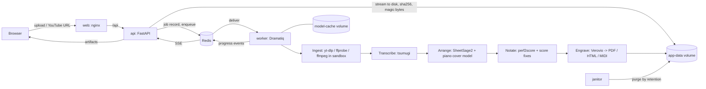

# PianoScribe 2 architecture

PianoScribe 2 is a rebuild of [the first PianoScribe](https://github.com/FriendlyUser/pianoscribe)
around one priority: the score has to be right. The first version transcribed with a 2021 piano
model and wrote notation with hand-made rules; measured against a published piano arrangement it
scored 0.40, then 0.73 after a second pass. This version replaces every musical stage with current
models from Hugging Face, scores 0.83 on the same reference from the YouTube link (0.82 to 0.86 over fourteen sampled
arrangements), and keeps that number honest with tests against ground truth. Model choice, benchmarks and licences are in
[docs/MODELS.md](docs/MODELS.md); how accuracy is measured is in
[backend/eval/README.md](backend/eval/README.md).

The service layer (API, queue, ingestion sandbox, storage, engraving, web UI) is carried over from
version 1 and is described here as it now stands.

## Stack at a glance

| Concern | Choice | Why |
|---|---|---|
| API | Python 3.12, FastAPI, uvicorn | Typed request/response models, streaming request bodies, SSE |
| Job system | Dramatiq 2 on Redis 7 | At-least-once delivery, retries with backoff, dead-letter queue |
| Job state and progress | Redis (JSON records, pub/sub, per-job locks) | One dependency for queue, state and live updates |
| Decoding | ffmpeg / ffprobe, sandboxed | The only code that parses untrusted media |
| YouTube | yt-dlp (+ Deno JS runtime), sandboxed | Invoked only with a URL rebuilt from a validated video id |
| Stem separation + transcription | [tsumugi](https://github.com/anime-song/tsumugi) | Instrument-agnostic transcriber with its own stem workflow, instrument labels and a velocity model; matches the best piano-only model on MAESTRO |
| Beats, bars, meter, key, melody, chords | [SheetSage2-Refined](https://huggingface.co/anime-song/SheetSage2-Refined) | One model for the whole metrical frame, including per-bar time signatures |
| Arranging a song for piano | [tsumugi-piano-cover-v2](https://huggingface.co/anime-song/tsumugi-piano-cover-v2) | Generates a playable two-hand part that follows the original on its beat grid |
| Performance to notation | `piano_perf2score` (same repository) | Learned note values, voices, hands, ties, key and clef; writes MusicXML |
| Model runtime | Each model in the environment its authors lock, run as a subprocess | No dependency conflicts, GPU memory released between stages, a hang or crash cannot take the worker down |
| Canonical notation | MusicXML 4.0 | Open interchange format |
| Engraving | Verovio 6 | SVG pages, timing map and MIDI from the same loaded score |
| PDF | CairoSVG + pypdf | Vector PDF from the engraved pages, no browser in the worker |
| Frontend | React 18, TypeScript, Vite; nginx | Small static bundle, typed API client |
| Packaging | Docker Compose, multi-stage images | `docker compose up` runs everything |

## System diagram



## The two paths

```
song (band, vocals, orchestra, soundtrack)
  audio.wav ─► transcription.mid ─► annotation.json + performance.mid ─► score.musicxml ─► PDF / HTML / MIDI
              stems, every          beats, bars, meter,  a piano part     note values,
              instrument's notes    melody, chords       for two hands    hands, key

solo piano
  audio.wav ─► performance.mid ─► annotation.json ─► score.musicxml ─► PDF / HTML / MIDI
              the notes played,    beats, bars,
              with dynamics        meter
```

**Song.** `tsumugi` separates the recording into stems and transcribes each one, giving a
multi-track MIDI of everything that sounds. `SheetSage2-Refined` listens to the recording for the
beat grid, bar lines, time signatures, melody and chords. The cover model then writes a piano
performance conditioned on both: it is a generative model, so the result is an *arrangement* that
a pianist can play, not a record of any one instrument. The cover is sampled with a fixed seed
(`PS_COVER_SEED`), so the same recording gives the same score.

**Solo piano** (the "This is already solo piano" option). Nothing is arranged. `tsumugi`
transcribes the recording restricted to the piano label, its velocity model adds dynamics, and
`SheetSage2-Refined` supplies the beat grid. The notes in the score are the notes that were played.

Both paths end in the same notation stage, `piano_perf2score`, which reads a performance against
a beat grid and writes notation: note values, ties, voices, the split between hands, key
signatures and clefs.

### What this project adds around the models

`backend/model_scripts/` holds the drivers that run inside the model environments. The score
writer is used through its Python API rather than its command line, because four faults in its
default behaviour showed up in grounded testing. Each fix is a small pure function in
`score_fixes.py` with unit tests, and each one was kept only because it raised a measured score.

| Fault observed | Fix | Effect on the Scene Shifts There benchmark |
|---|---|---|
| A bar the beat model leaves without a time signature (typically the pickup) let the score model guess the meter for the whole piece: 6/8 came out as 3/4. | `complete_meters`: a bar without a meter takes its neighbours' beat unit and its own length. | overall 0.78 → 0.83, meter correct |
| The cover model often plays the first chord just before the first downbeat; written literally it becomes a pickup of tied fragments. | `settle_anticipation`: notes within a short window before the first downbeat move onto it. | cleaner first bar, same score |
| The score model writes its first bar without context, at double speed with invented notes. | Warm-up: the opening two bars are given to the model twice, and the measures written for the first copy are dropped (`plan_warmup`, `warmed_annotation`, `drop_warmup`). Notes struck just ahead of the next downbeat are left out of the copy, or they reappear as an invented first note (`warm_events`). | overall 0.83 → 0.86 |
| The beat model sometimes marks every other bar line (bars of N and 2N beats mixed), or swallows an anacrusis into the first bar. | `regularize_bars`: double-length bars are split where the short bar is common, and a long first bar gives up its pickup. | bar placement 0.89 → 0.91; Für Elise opening 0.76 → 0.90 |

`app/models/fidelity.py` computes `melody_fidelity`: the share of the detected
melody that the arrangement plays in time. It is reported with each arrangement. It was tried as a
way to pick the best of several sampled covers and rejected: across six covers it did not
correlate with the reference score (and all fourteen covers measured scored 0.82 to 0.86), so one cover is generated
(`PS_COVER_CANDIDATES=1`).

### Running the models

`app/models/runtime.py` runs each model step as a subprocess in the model's own virtual
environment (`/opt/models/<name>/.venv`), in its own process group with a wall-clock limit. The
worker process itself has no PyTorch. This has three practical effects: the models keep the exact
dependency sets their authors test with; all GPU memory is returned between stages, which is what
lets a three-model chain run on an 8 GB card; and a model that crashes, hangs or runs out of memory
fails one job with a clear message instead of taking the worker down. The transcriber compiles
its GPU kernels on first use (`torch.compile`), which is why the worker image carries gcc.

Weights download on first use into the `model-cache` volume (about 4.5 GB) from Hugging Face.

## Request and job lifecycle

1. **Submit.** The browser validates extension, size and leading bytes (or the YouTube URL), then
   posts the file as a raw streamed body, or the URL as JSON.
2. **Ingest (API side).** The upload is streamed to disk with a running byte count (size limit
   enforced mid-stream), hashed with SHA-256, and its magic bytes are checked against its
   extension as soon as 4 KB has arrived. A YouTube URL is parsed to a video id.
3. **Deduplicate.** The job id is `sha256(pipeline version | source kind | content hash or video id | options)`.
   Submitting creates the record with an atomic `SET NX`:
   - finished and artifacts present → returned immediately as a cache hit;
   - queued or running → the caller is attached to the in-flight job;
   - failed or expired → reset and re-queued.
4. **Run.** The worker takes a per-job Redis lock (heartbeat-renewed, self-expiring), then runs the
   stages. Each model stage writes its output atomically to `work/<job>/` and is skipped if that
   output already exists, so a retried job resumes after the last completed stage instead of
   repeating minutes of GPU work.
5. **Progress.** Every stage transition and progress tick updates the job record and publishes it;
   the API relays these as Server-Sent Events (the client falls back to polling).
6. **Finish.** Artifacts are written to a staging directory and renamed into place; the record is
   marked `succeeded`; the working directory and raw media are deleted.

### Failure handling

| Failure | Behaviour |
|---|---|
| Bad input (too long, no audio, unreadable, private video …) | `JobError` with a stable code and a user-facing message; job fails at once, no retry, not dead-lettered |
| Transient extraction failure | Retried inside the stage with exponential backoff and jitter |
| GPU out of memory, or a model step over its time limit | Job fails with `gpu_out_of_memory` / `model_timeout` and a message; not retried |
| A model step exits with an error | `model_failed`, retried by the queue up to `PS_JOB_MAX_RETRIES`; the last 40 lines of the model's output are logged |
| Retries exhausted | Message moves to the dead-letter queue; the job is marked `failed` with `dead_lettered=true`; `app.cli dead-letters` / `requeue` for operators |
| Worker killed mid-job | The message was never acked; once the worker's heartbeat lapses the broker re-queues it and the next delivery resumes from stage checkpoints |
| Duplicate delivery | Lock held → re-scheduled; job already terminal → no-op |

## Security model

- **SSRF.** The user's URL is never fetched. It is parsed; scheme, host (allow-list of YouTube
  hosts), port and credentials are validated; an 11-character id is extracted; and the downloader
  is called with `https://www.youtube.com/watch?v=<id>` built from that id. Playlists, live
  streams and over-length videos are rejected from metadata before any download.
- **Untrusted media.** Only ffprobe/ffmpeg/yt-dlp touch untrusted bytes, each as a subprocess with
  no shell, a minimal environment, its own session, `setrlimit` caps on address space, CPU time,
  file size and open files, `no_new_privs`, and a wall-clock timeout. ffmpeg is restricted to the
  `file` and `pipe` protocols. The models only ever see the WAV that ffmpeg wrote.
- **Containers.** API, worker and janitor run as a non-root user on a read-only root filesystem
  with all capabilities dropped and `no-new-privileges`; the worker also has memory and pid limits.
- **Uploads.** Client filenames are display labels only; files are stored under their content
  hash. Content type is established by magic bytes plus ffprobe, not by extension or headers.
- **Outputs.** Titles are escaped in the HTML export, which is served with a CSP that forbids all
  network access and embedded in a sandboxed iframe. Artifact names are an allow-list.
- **Retention.** Raw media is deleted as soon as it is decoded (or rejected). The janitor purges
  uploads and work files older than `PS_RAW_RETENTION_SECONDS` and results older than
  `PS_RESULT_RETENTION_SECONDS`.
- **Model supply chain.** The model programs are third-party code. They are fetched at pinned
  commits when the image is built (`TSUMUGI_REF`, `COVER_REF` in `backend/Dockerfile`; the cover
  environment is a full pin list, `requirements/cover-env.txt`) and run as the unprivileged
  container user. Weights come from Hugging Face at run time and are not pinned by hash; pin
  revisions or bake the weights into the image for a deployment that needs that guarantee.

## Engraving and export consistency

MusicXML is the single canonical representation. One Verovio toolkit instance loads it once and
produces everything else:

- **PDF:** the print-layout SVG pages (A4 or Letter) are converted to vector PDF and concatenated.
- **HTML:** the same print pages, plus a narrow reflowed layout for phones, inlined into one
  self-contained file with the music font, a timing map and a small Web Audio player.
- **MIDI:** `score.mid` is rendered by Verovio from the score; `performance.mid` is the piano
  performance before notation (original timing and dynamics); `transcription.mid` (songs only) is
  the multi-instrument transcription the arrangement was made from.

Because the PDF pages and the HTML's wide layout are the same SVGs, they are identical by
construction. The web app's viewer is that HTML file in an iframe.

## Observability

Structured JSON logs (structlog). The worker binds `job_id`, the API binds `request_id`, to every
line. Each stage logs `pipeline.stage` with its wall time and each model step logs `model.step`
with its outcome; per-stage timings are stored on the job record and returned by the API.

## Reproducible builds

- The worker's own dependencies are compiled to hash-pinned lock files and installed with
  `--require-hashes`:

  ```bash
  cd backend/requirements
  uv pip compile api.in --python-version 3.12 --generate-hashes -o api.txt
  uv pip compile worker.in --python-version 3.12 --generate-hashes -c api.txt -o worker.txt
  uv pip compile dev.in --python-version 3.12 --generate-hashes -o dev.txt
  ```

- `tsumugi` is installed from its own `uv.lock` (`uv sync --locked`). The cover model's
  environment is installed from `requirements/cover-env.txt`, a freeze of the environment the
  benchmarks in this repository were run with.
- The frontend uses `npm ci` against `package-lock.json`; its unit tests and type check run as
  part of the image build.

## Known limitations

**Musical**

- A song's score is an arrangement written by a generative model. It follows the melody, bass and
  harmony of the recording closely (see the benchmark), but inner voices and figuration are the
  model's own, and it can add or drop a note. It is a strong first draft for a pianist, not an
  urtext.
- The beat unit can be wrong while everything else is right: Für Elise (3/8) is written in 3/4
  with every note value doubled. The notes and bar lines are correct and the music reads, but the
  time signature is not the composer's. This is pinned by an expected-failure test.
- Arrangements are sampled, so quality varies a little from one to the next (0.82 to 0.86 on the
  benchmark). Now and then the first bar is the weak one: in the default run of the
  benchmark song the opening five-note figure is reduced to its third and fourth notes. Changing `PS_COVER_SEED` gives a different arrangement.
- Key changes are followed unreliably. The benchmark song goes F, D, C, F. Across arrangements,
  the share of bars under the right key signature ranged from 0.42 to 0.93; the commonest miss is
  the return to F. A rule that splits a long stretch where a new signature clearly needs fewer
  accidentals found that change every time, but it also invented a key change in Satie's first
  Gymnopédie, so it was not adopted.
- Key signatures need context. A 32-second clip of Für Elise (A minor) is written with one
  sharp; the full recording gets no sharps, correctly. A check based on key profiles was tried
  and dropped: it fixed one encoding of the clip and not another.
- Bar lines follow the beat model. Where a pianist slows down or lingers, it can count an extra
  beat, and a bar of 5/4 or 4/4 appears in a 3/4 piece. The notes are still right.
- The models are trained mostly on Japanese pop, anime and game music plus piano repertoire.
  Expect the best results there and weaker ones on, for example, dense orchestral or jazz
  recordings. One benchmark song and a handful of piano pieces are not a broad evaluation.
- Bass accuracy (0.73 on the benchmark) is the weakest measured dimension of arrangements: the
  left hand sometimes takes a chord tone other than the one a human arranger chose.
- Solo piano scores keep the notes that were played, but left-hand notes near middle C are
  sometimes written on the upper staff.
- No fingering, and articulation is limited to what the score model writes (slurs, pedal,
  dynamics, hairpins).

**System**

- A GPU is needed in practice. On an RTX 4060 (8 GB) a 4.4-minute song takes five to six minutes
  and a 30-second piano clip a minute and a half; CPU-only runs are untested beyond start-up and
  will be many times slower.
- The worker image is large (about 11 GB: two PyTorch environments) and the weights add 4.5 GB.
- **Licence.** The beat model's and the cover/score model's weights are CC BY-NC 4.0, so the
  system is for non-commercial use only. See [docs/MODELS.md](docs/MODELS.md#licences).
- YouTube extraction depends on yt-dlp keeping up with YouTube and can be blocked for server IPs.
- The sandbox is rlimits plus container hardening. There is no per-process seccomp profile or
  network namespace, and the worker's network egress is not restricted.
- No authentication, per-user quotas or multi-tenancy; rate limiting is per IP at nginx. Job ids
  are derived from content, so anyone holding the same file (or video id) can read its cached score.
- Playback is a simple synthesiser playing the score, not the original audio.
- Redis is a single node holding queue and state; artifacts are on a local volume.

## Scaling to multi-node production

- **Storage.** Replace the two filesystem interfaces (`ArtifactStore`, the uploads/work
  directories) with object storage, and upload stage checkpoints so another node can resume a job.
- **Queue and state.** Move job records to Postgres and keep Redis (HA or managed) for queueing
  and pub/sub. Keep the deterministic job id as the idempotency key.
- **Worker pools.** Split the single actor into per-stage queues: CPU ingest workers (network
  access, strongest sandbox), GPU model workers (no internet), CPU engraving workers. The stage
  checkpoints already make this split possible.
- **Model serving.** Each model step currently loads its weights per job (roughly a minute of a
  five-minute job). At volume, keep the models resident in long-lived per-model server processes
  and batch across jobs.
- **Isolation.** Run ingest in gVisor/Kata or Firecracker with an egress proxy that only allows
  YouTube endpoints.
- **API.** Stateless replicas behind a load balancer; SSE works across replicas because progress
  travels through Redis pub/sub. Add authentication, per-user quotas and an admission limit on
  queue depth.
